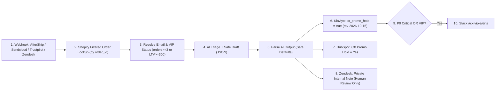

# CX-to-CRM AI Promo Guard & Proactive Recovery Workflow

An **n8n + AI Triage + Klaviyo / HubSpot / Zendesk / Shopify** automation blueprint that stops promotional emails and automated review requests from ever reaching customers with a delayed parcel, a 1–2 star Trustpilot review, or an open support ticket — and automatically releases the hold once the issue is resolved.

**[Explore the interactive workflow walkthrough](https://errer441122.github.io/cx-crm-promo-guard/)** · **[Download Promo Guard blueprint](workflows/cx-promo-guard.n8n.json)** · **[Download Hold Release blueprint](workflows/cx-hold-release.n8n.json)** · **[Error Notifier](workflows/error-notifier.n8n.json)**

> **Live Testing & Scope:** Importable 10-node real-time Promo Guard + 6-node daily Hold Release + 2-node standalone Error Workflow designed for Klaviyo (`revision: 2026-10-15`), HubSpot Free CRM, Shopify Dev Store (`orders.json` filtered by `order_id`), and Slack (`#cx-vip-alerts`). Carrier/Trustpilot triggers use simulated webhook payloads; Zendesk internal note node can run on a sandbox trial or swap 1-for-1 with HubSpot Tickets.

---

## The Business Problem

Shipping platforms, Trustpilot, and Zendesk know immediately when a customer is unhappy — **marketing automation tools usually do not**:
- A customer waiting on a stuck parcel still receives your promotional newsletter and your *"How did we do?"* review request, triggering unsubscribes, spam complaints, and 1-star public reviews.
- A VIP customer with an urgent open Zendesk ticket receives a discount blast because Support and CRM operate in separate silos.
- Carrier and review exports frequently identify orders by `order_id` / `Reference Id` without an email address, making manual suppression slow and error-prone.

---

## System Architecture (Paired n8n Workflows + Standalone Error Workflow)

### Workflow 1: Real-Time Hold, AI Triage & VIP Escalation ([`workflows/cx-promo-guard.n8n.json`](workflows/cx-promo-guard.n8n.json))

*Global safety net:* link [`workflows/error-notifier.n8n.json`](workflows/error-notifier.n8n.json) under **Settings → Error Workflow** in n8n so any API failure alerts `#martech-alerts`.

### Workflow 2: Daily Cooldown & Automatic Release ([`workflows/cx-hold-release.n8n.json`](workflows/cx-hold-release.n8n.json))

Runs daily at **07:30 CET** so resolved customers are never trapped permanently on a suppression list:
`HOLD (issue active) → COOLDOWN (7d after late delivery / 30d after 1–2★ review) → RELEASE (cx_promo_hold = false)` once zero open tickets remain.

---

## Built-In Operational & AI Safety Guardrails

| Guardrail | How It Works | Reference |
| --- | --- | --- |
| **Human-in-the-loop AI replies** | The AI drafts a concise empathetic response strictly as a **private Zendesk Internal Note** — it never emails frustrated customers autonomously and is explicitly forbidden from promising unapproved refunds or discounts | [`prompts/cx-triage-and-draft-prompt.md`](prompts/cx-triage-and-draft-prompt.md) |
| **VIP P0 escalation & Chargeback detection** | Cross-references Shopify order count/spend (`orders >= 3` or `LTV >= €300`) and scans for chargeback/legal keywords to escalate immediately to `#cx-vip-alerts` | [`workflows/cx-promo-guard.n8n.json`](workflows/cx-promo-guard.n8n.json) |
| **Review-request pause** | Sets `cx_review_request_hold = true` alongside `cx_promo_hold = true`, preventing automated post-purchase review prompts from firing on late parcels | [`docs/state-machine-and-crm-rules.md`](docs/state-machine-and-crm-rules.md) |
| **No-webhook CSV fallback** | Includes ready-to-import Klaviyo & HubSpot CSV suppression templates for teams without carrier webhooks | [`templates/`](templates/) |

---

## Repository Structure

| Path | Content |
| --- | --- |
| `workflows/cx-promo-guard.n8n.json` | 10-node real-time n8n blueprint (Filtered Shopify lookup, `resolved_email` + VIP OR escalation, AI Triage, Klaviyo rev `2026-10-15`, HubSpot Hold, Zendesk Internal Note) |
| `workflows/cx-hold-release.n8n.json` | 6-node scheduled n8n blueprint handling automatic cooldown release (`revision: 2026-10-15`) |
| `workflows/error-notifier.n8n.json` | Standalone 2-node Error Workflow routing execution failures to `#martech-alerts` |
| `prompts/cx-triage-and-draft-prompt.md` | Priority rubric (`P0`–`P3`), multilingual triage prompt & brand-safety rules |
| `docs/state-machine-and-crm-rules.md` | State machine (`HOLD → COOLDOWN → RELEASE`) & Klaviyo/HubSpot segment definitions |
| `docs/sop-cx-crm-operations.md` | 1-page daily CRM + Customer Care SOP |
| `templates/` | Ready-to-import Klaviyo & HubSpot CSV suppression templates |
| `docs/index.html` | Interactive visual workflow explorer (GitHub Pages) |

## License

MIT. See [LICENSE](LICENSE).
