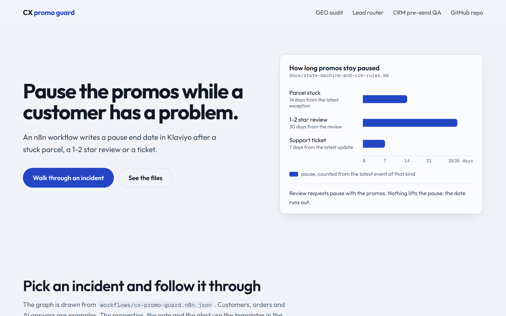
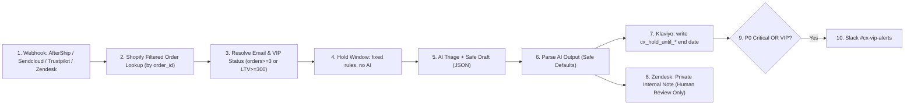

# CX-to-CRM AI Promo Guard & Proactive Recovery Workflow

An **n8n + AI Triage + Klaviyo / Zendesk / Shopify** automation blueprint that keeps promotional emails and automated review requests away from customers with a stuck parcel, a 1–2 star review, or an open support ticket. Each problem writes an **end date** on the Klaviyo profile, so the pause lifts by itself: no release job.

**[Explore the interactive workflow walkthrough](https://errer441122.github.io/cx-crm-promo-guard/)** · **[Download Promo Guard blueprint](workflows/cx-promo-guard.n8n.json)** · **[Error Notifier](workflows/error-notifier.n8n.json)**

> **What is real and what is a test:** importable 10-node n8n blueprint + 2-node standalone Error Workflow, designed for Klaviyo (API `revision: 2026-10-15`), a Shopify store (`orders.json` filtered by order name), Zendesk and Slack (`#cx-vip-alerts`). It has **not run against live accounts yet**: the carrier, review and ticket events on the walkthrough page are example payloads, and the Klaviyo segment below is a setup instruction, not a screenshot of a live account.

---

## The Business Problem

Shipping platforms, review tools, and Zendesk know immediately when a customer is unhappy — **marketing automation tools usually do not**:
- A customer waiting on a stuck parcel still receives your promotional newsletter and your *"How did we do?"* review request, triggering unsubscribes, spam complaints, and 1-star public reviews.
- A VIP customer with an urgent open Zendesk ticket receives a discount blast because Support and CRM operate in separate silos.
- Carrier and review exports frequently identify orders by `order_id` / `Reference Id` without an email address, making manual suppression slow and error-prone.

---

## System Architecture (One n8n Workflow + Standalone Error Workflow)

### Real-Time Pause, AI Triage & VIP Escalation ([`workflows/cx-promo-guard.n8n.json`](workflows/cx-promo-guard.n8n.json))

*Global safety net:* link [`workflows/error-notifier.n8n.json`](workflows/error-notifier.n8n.json) under **Settings → Error Workflow** in n8n so any API failure alerts `#martech-alerts`.

### How the Pause Ends (No Release Job)

| Problem | Property on the Klaviyo profile | Pause |
| --- | --- | --- |
| Carrier exception (AfterShip / Sendcloud) | `cx_hold_until_delivery` | 14 days from the latest exception |
| 1–2 star review (Trustpilot) | `cx_hold_until_review` | 30 days from the review |
| Zendesk ticket update | `cx_hold_until_ticket` | 7 days from the latest update, solved included |

The Klaviyo segment **`CX hold active`** contains anyone with at least one of these dates in the future. Every promotional campaign excludes it, and the review request flow starts with a conditional split on the same three conditions. When the last date passes, the customer is back in the normal flows. One date per kind of problem means a short ticket pause never cuts a 30-day review pause. Full rules: [`docs/state-machine-and-crm-rules.md`](docs/state-machine-and-crm-rules.md).

---

## Built-In Operational & AI Safety Guardrails

| Guardrail | How It Works | Reference |
| --- | --- | --- |
| **The AI does not set policy** | Pause lengths come from fixed rules in the `Hold Window` node. The AI only sets priority, theme, owner team, and a draft | [`workflows/cx-promo-guard.n8n.json`](workflows/cx-promo-guard.n8n.json) |
| **Human-in-the-loop AI replies** | The AI drafts a concise empathetic response strictly as a **private Zendesk Internal Note**; it never emails customers and is forbidden from promising unapproved refunds or discounts | [`prompts/cx-triage-and-draft-prompt.md`](prompts/cx-triage-and-draft-prompt.md) |
| **VIP P0 escalation & chargeback detection** | Cross-references Shopify order count/spend (`orders >= 3` or `LTV >= €300`) and flags chargeback/legal keywords as P0; P0 or VIP posts to `#cx-vip-alerts` | [`workflows/cx-promo-guard.n8n.json`](workflows/cx-promo-guard.n8n.json) |
| **Review-request pause** | The review request flow checks the same end dates before sending | [`docs/state-machine-and-crm-rules.md`](docs/state-machine-and-crm-rules.md) |
| **No-webhook CSV fallback** | A Klaviyo import template with the same date properties, for tools without webhooks | [`templates/`](templates/) |

---

## Repository Structure

| Path | Content |
| --- | --- |
| `workflows/cx-promo-guard.n8n.json` | 10-node n8n blueprint (filtered Shopify lookup, `resolved_email` + VIP check, fixed pause rules, AI triage, Klaviyo end date, Zendesk internal note, P0/VIP Slack alert) |
| `workflows/error-notifier.n8n.json` | Standalone 2-node Error Workflow routing execution failures to `#martech-alerts` |
| `prompts/cx-triage-and-draft-prompt.md` | Priority rubric (`P0`–`P3`), multilingual triage prompt & brand-safety rules |
| `docs/state-machine-and-crm-rules.md` | Pause rules, why three end dates, Klaviyo segment and review-flow split |
| `docs/sop-cx-crm-operations.md` | 1-page daily CRM + Customer Care SOP |
| `templates/` | Klaviyo CSV import template for the no-webhook fallback |
| `docs/index.html` | Interactive visual workflow explorer (GitHub Pages) |

## License

MIT. See [LICENSE](LICENSE).
