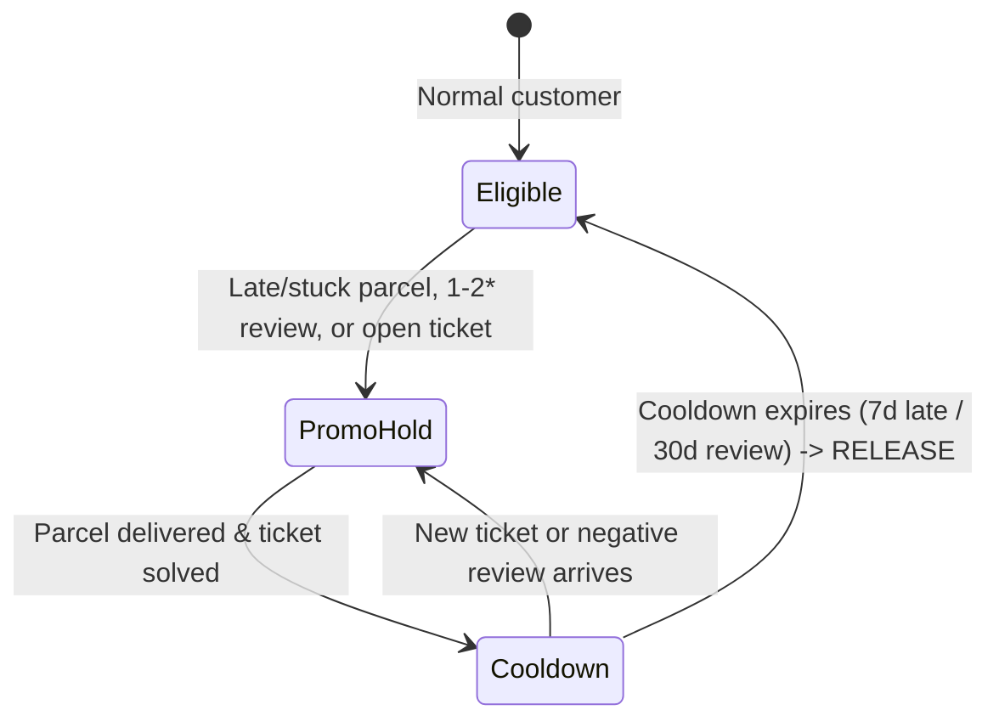

# CX Promo Hold State Machine & CRM Exclusion Rules

## 1. Trigger Rules & Hold Windows

| Signal Source | Trigger Condition | CRM Flags Set | Hold Window |
| --- | --- | --- | --- |
| **Carrier / AfterShip / Sendcloud** | `status` in (`exception`, `failed_attempt`, `lost`, `stuck`) OR past promised date & undelivered | `cx_promo_hold = true` · `cx_review_request_hold = true` | Until delivered + **7 days** cooldown |
| **Carrier / Logistics** | Delivered late (after promised date) | `cx_promo_hold = true` · `cx_review_request_hold = true` | **7 days** from delivery date (gives CS time for apology follow-up) |
| **Trustpilot / Judge.me / Yotpo** | Rating **1 or 2 stars** | `cx_promo_hold = true` · `cx_review_request_hold = true` | **30 days** from review date |
| **Zendesk / HubSpot Tickets** | Ticket status `new`, `open`, `pending`, or `hold` | `cx_promo_hold = true` · `cx_review_request_hold = true` | Until ticket status = `solved` / `closed` |

## 2. ESP / CRM Segment Setup (2 Minutes)

- **Klaviyo:** Create a segment named **`Global Exclusion — Active CX Hold`** with definition: `Properties about someone -> cx_promo_hold equals true`. Attach this segment as a default exclusion on all promotional campaigns and as a profile filter (`cx_review_request_hold is not true`) on the Post-Purchase Review Request flow.
- **HubSpot:** Create an Active List named **`CX Promo Hold (Active)`** where `CX Promo Hold is any of Yes` and add it to the global campaign suppression list.

## 3. Why the Companion Release Workflow Matters

Without [`workflows/cx-hold-release.n8n.json`](../workflows/cx-hold-release.n8n.json), suppressed customers accumulate forever and shrink the marketable database. Running the daily 07:30 CET check ensures every resolved customer returns cleanly to normal lifecycle flows once their cooldown clears.
