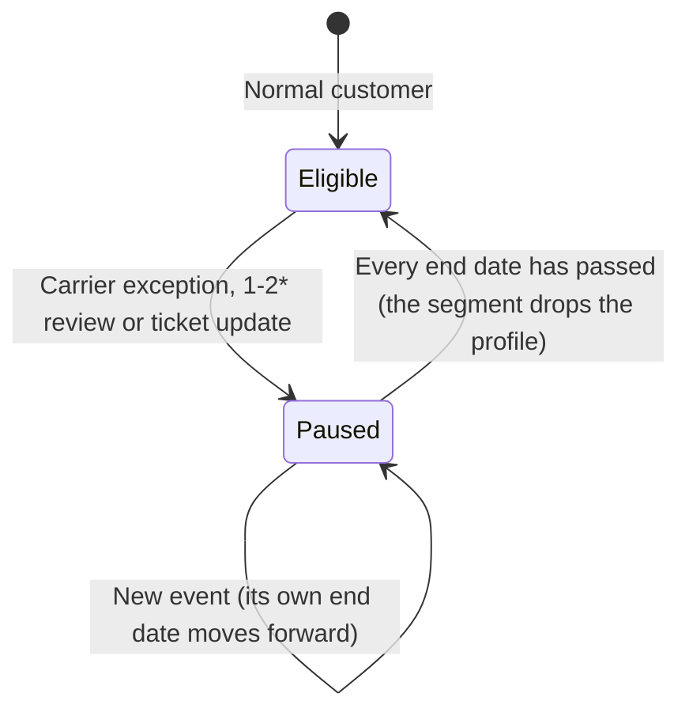

# CX Promo Pause: End Dates & Klaviyo Rules

Nothing ever has to "release" a customer. Each problem writes an **end date** on the Klaviyo profile, and the customer stays paused while any end date is in the future.

## 1. Pause Rules (fixed, in the node `Hold Window (Fixed Rules, No AI)`)

| Event (webhook `source`) | Property written | Pause length | Notes |
| --- | --- | --- | --- |
| **Carrier exception** (`aftership`, `sendcloud`): stuck, failed attempt, lost, late in transit | `cx_hold_until_delivery` | **14 days** from the latest exception | Every new exception moves the date forward. Send exceptions only, not normal deliveries |
| **1-2 star review** (`trustpilot`) | `cx_hold_until_review` | **30 days** from the review | Send only 1-2 star reviews to the webhook |
| **Support ticket update** (`zendesk`) | `cx_hold_until_ticket` | **7 days** from the latest update, solved included | While the ticket keeps moving, the date keeps moving; the pause ends 7 days after the last update |

**Why three dates instead of one flag:** with a single date, a 7-day ticket pause written after a 30-day review pause would shorten it. With one date per kind of problem, a shorter pause never cuts a longer one.

The workflow also writes `cx_hold_reason` and `cx_priority_tier` (from the AI triage) so anyone opening the profile sees why.

## 2. Klaviyo Setup (5 Minutes)

- **Segment `CX hold active`**, under *Properties about someone*, with the three conditions joined by **OR**:
  - `cx_hold_until_delivery` is in the next 60 days
  - `cx_hold_until_review` is in the next 60 days
  - `cx_hold_until_ticket` is in the next 60 days

  Select it under **Don't send to** on every promotional campaign. When the last date passes, the profile leaves the segment by itself.
- **Review request flow:** the first step is a **conditional split** with the same three conditions. Yes: the flow ends for this customer. No: the review request goes out.

Klaviyo counts these days in UTC, and the workflow writes UTC timestamps (`YYYY-MM-DD HH:MM:SS`), so a pause can end up to a day early, never late.

## 3. No-Webhook Fallback

For carriers or review tools without webhooks, fill [`templates/klaviyo-global-exclusion-template.csv`](../templates/klaviyo-global-exclusion-template.csv) each morning and import it into Klaviyo. It carries the same date properties, so the same segment and split apply.
